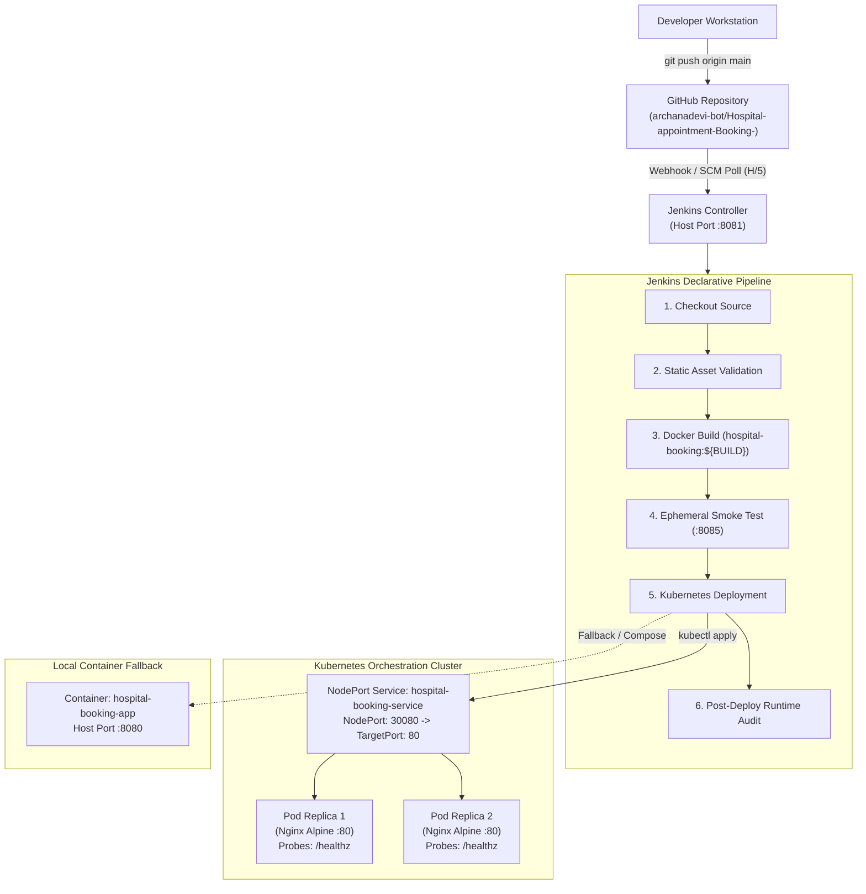

# 🏥 Hospital Appointment Booking System — End-to-End DevOps Project

[](https://www.jenkins.io/)
[](https://www.docker.com/)
[](https://kubernetes.io/)
[](https://nginx.org/)
[](https://aws.amazon.com/ec2/)
[](https://github.com/archanadevi-bot/Hospital-appointment-Booking-)

An enterprise-ready DevOps implementation for a production-grade **Hospital Appointment Booking System**. This project transforms an existing multi-page HTML5/CSS3/JavaScript web application into a fully automated, containerized, and orchestrated cloud deployment pipeline.

---

## 📑 Table of Contents

- [Project Overview & Problem Statement](#-project-overview--problem-statement)
- [DevOps Architecture](#-devops-architecture)
- [Tools & Technology Stack](#-tools--technology-stack)
- [Documentation Index](#-documentation-index)
- [Repository Directory Structure](#-repository-directory-structure)
- [Step-by-Step Implementation Guide](#-step-by-step-implementation-guide)
  - [1. Running Frontend Locally](#1-running-the-frontend-locally)
  - [2. Building Docker Image](#2-building-the-docker-image)
  - [3. Running Docker Container](#3-running-the-docker-container)
  - [4. Multi-Container with Docker Compose](#4-using-docker-compose)
  - [5. GitHub Version Control Workflow](#5-pushing-code-to-github)
  - [6. Installing & Configuring Jenkins](#6-installing-and-configuring-jenkins)
  - [7. Executing Jenkins CI/CD Pipeline](#7-executing-the-cicd-pipeline)
  - [8. Starting Local Kubernetes Cluster](#8-starting-kubernetes)
  - [9. Applying Kubernetes Manifests](#9-applying-kubernetes-manifests)
  - [10. Scaling the Application](#10-scaling-the-application)
  - [11. Performing Zero-Downtime Rolling Updates](#11-performing-rolling-updates)
  - [12. Rolling Back a Deployment](#12-rolling-back-a-deployment)
- [Testing & Verification Results](#-testing--verification-results)
- [Troubleshooting Guide](#-troubleshooting-guide)
- [Project Limitations & Realities](#-project-limitations)
- [Future Enhancements](#-future-enhancements)
- [Placement Interview Preparation](#-placement-interview-preparation)

---

## 🩺 Project Overview & Problem Statement

### Problem Statement
Traditional static web applications often suffer from environment inconsistency ("works on my machine"), manual, error-prone deployment procedures, downtime during application updates, and lack of automated health monitoring and self-healing when services fail.

### Project Objectives
1. **Containerization**: Standardize the runtime environment using lightweight Alpine Linux and Nginx reverse proxy.
2. **Automated CI/CD**: Eliminate manual builds and tests using a declarative 6-stage Jenkins pipeline triggered by GitHub pushes.
3. **Container Orchestration**: Ensure 100% uptime, horizontal scalability, automated failover, and zero-downtime rolling updates using Kubernetes.
4. **Cloud Readiness**: Define an automated AWS EC2 cloud hosting architecture without incurring unnecessary cloud costs during development.

### Application Workflow & Features
The application is a pure client-side Multi-Page Application (MPA) for outpatient medical appointments:
1. **`index.html` (Landing Page)**: Hero header with medical banner image, leading users to doctor directory or booking form.
2. **`doctors.html` (Doctor Directory)**: Dynamically renders doctor cards from `app.js` (Dr. Smith, Dr. Jones, etc. across 8 specialties). Clicking "Book Appointment" saves the selected doctor ID into browser `localStorage` and routes to `booking.html`.
3. **`booking.html` (Appointment Form)**: Doctor dropdown auto-prefilled from directory selection. Features conflict detection (prevents overlapping bookings for the same doctor on the same date). Stores finalized appointments into `localStorage`.
4. **`confirmation.html` (Bookings Dashboard)**: Lists all confirmed appointments from `localStorage` with real-time cancel/delete capabilities.

---

## 🏗️ DevOps Architecture



---

## 🛠️ Tools & Technology Stack

| Domain | Technology | Version | Purpose |
|---|---|---|---|
| **Frontend** | HTML5, CSS3, JavaScript (ES6) | Standard | Client-side application with localStorage state |
| **Web Server** | Nginx Alpine | 1.27-alpine | High-performance reverse proxy, gzip compression & caching |
| **Containerization** | Docker Engine | 29.x / Latest | Application packaging with custom non-root configs |
| **Multi-Container** | Docker Compose | v2 spec | Local multi-service orchestration with resource limits |
| **Version Control** | Git & GitHub | 2.x | Source control, branching, release tags, and webhooks |
| **CI/CD Automation**| Jenkins | LTS | Declarative pipeline for automated build, test & deploy |
| **Orchestration** | Kubernetes (k8s) | 1.36+ | Declarative deployments, replica sets, NodePort routing |
| **Cloud Hosting** | Amazon Web Services (AWS) | EC2 (Blueprint) | Cloud virtual machine hosting with Security Groups |

---

## 📚 Documentation Index

Comprehensive engineering guides are available in the [`docs/`](file:///c:/Users/archa/Downloads/Hospital-appointment-Booking--main/docs) directory:

1. [**`docs/ARCHITECTURE.md`**](file:///c:/Users/archa/Downloads/Hospital-appointment-Booking--main/docs/ARCHITECTURE.md): System architecture, data flow diagrams, network mapping, and security models.
2. [**`docs/DOCKER_GUIDE.md`**](file:///c:/Users/archa/Downloads/Hospital-appointment-Booking--main/docs/DOCKER_GUIDE.md): In-depth Dockerfile, Nginx optimization, and Compose reference.
3. [**`docs/JENKINS_CICD.md`**](file:///c:/Users/archa/Downloads/Hospital-appointment-Booking--main/docs/JENKINS_CICD.md): Jenkins setup, plugins, pipeline stage mechanics, and webhook troubleshooting.
4. [**`docs/KUBERNETES_GUIDE.md`**](file:///c:/Users/archa/Downloads/Hospital-appointment-Booking--main/docs/KUBERNETES_GUIDE.md): Manifest specifications, rolling updates, self-healing, and scaling procedures.
5. [**`docs/AWS_FUTURE_DEPLOYMENT.md`**](file:///c:/Users/archa/Downloads/Hospital-appointment-Booking--main/docs/AWS_FUTURE_DEPLOYMENT.md): Future cloud deployment blueprint for EC2 and EKS with cost analysis.
6. [**`docs/INTERVIEW_PREPARATION.md`**](file:///c:/Users/archa/Downloads/Hospital-appointment-Booking--main/docs/INTERVIEW_PREPARATION.md): 35+ technical interview questions with answers and a 2-minute elevator pitch.

---

## 📁 Repository Directory Structure

```text
Hospital-appointment-Booking/
├── .dockerignore                 # Excludes local git, logs, and docs from Docker context
├── .gitignore                    # Prevents build artifacts and OS caches from Git tracking
├── 852d3ae66e2f216bcc1e074c7e0da8da.jpg  # Hero banner background image
├── app.js                        # Doctor dataset array (Root fallback)
├── booking.html                  # Appointment scheduling page with validation
├── confirmation.html             # Confirmed appointments management page
├── css/
│   └── style.css                 # CSS stylesheet in standard directory structure
├── docs/
│   ├── ARCHITECTURE.md           # System & network architecture document
│   ├── AWS_FUTURE_DEPLOYMENT.md  # Cloud hosting specification (Blueprint)
│   ├── DOCKER_GUIDE.md           # Dockerfile & Nginx deep dive
│   ├── INTERVIEW_PREPARATION.md  # 35+ Placement interview Q&As & elevator pitch
│   ├── JENKINS_CICD.md           # Pipeline stages & credentials reference
│   └── KUBERNETES_GUIDE.md       # Cluster manifests & scaling guide
├── docker-compose.yml            # Multi-container orchestration definition
├── Dockerfile                    # Production-grade multi-stage / Alpine Nginx image
├── doctors.html                  # Dynamic doctor card listing page
├── index.html                    # Application entry point / Landing page
├── Jenkinsfile                   # Declarative Jenkins CI/CD pipeline definition
├── js/
│   └── app.js                    # JavaScript data source in standard directory structure
├── k8s/
│   ├── configmap.yaml            # Environment metadata ConfigMap
│   ├── deployment.yaml           # Kubernetes Deployment (2 Replicas, probes, limits)
│   ├── namespace.yaml            # Dedicated namespace definition
│   └── service.yaml              # Kubernetes Service (NodePort 30080)
├── nginx.conf                    # Production Nginx server configuration with /healthz
├── README.md                     # Comprehensive main documentation & guide
└── scripts/
    └── deploy-aws.sh             # Bash automation script for EC2 server bootstrap
```

---

## 🚀 Step-by-Step Implementation Guide

### 1. Running the Frontend Locally
Open any browser and open `index.html` directly or serve via Python / Node.js:
```bash
# Serve locally using Node.js or Python
npx http-server -p 3000 .
# Open in browser: http://localhost:3000
```

### 2. Building the Docker Image
```bash
# Build the production Docker image (weighs only 21.1 MB)
docker build -t hospital-booking:latest .

# Verify image creation
docker images hospital-booking:latest
```

### 3. Running the Docker Container
```bash
# Run container mapping host port 8080 to container port 80
docker run -d --name hospital-booking-app -p 8080:80 hospital-booking:latest

# Check running container and health status
docker ps -f name=hospital-booking-app

# Verify in browser
curl -I http://localhost:8080/
curl http://localhost:8080/healthz
```

### 4. Using Docker Compose
```bash
# Launch application with resource limits and isolated network
docker compose up -d --build

# View container status
docker compose ps

# Stop containers and bridge network
docker compose down
```

### 5. Pushing Code to GitHub
```bash
# Check repository status and branch tracking
git status
git branch -vv

# Stage and commit changes
git add .
git commit -m "feat: complete DevOps pipeline implementation"

# Push to GitHub main branch
git push origin main
```

### 6. Installing and Configuring Jenkins
To prevent port conflict with port 8080, Jenkins runs on host port **8081**:
```bash
# Create persistent volume
docker volume create jenkins_home

# Run Jenkins with Docker socket integration
docker run -d \
  --name jenkins \
  --restart unless-stopped \
  -p 8081:8080 \
  -p 50000:50000 \
  -v jenkins_home:/var/jenkins_home \
  -v /var/run/docker.sock:/var/run/docker.sock \
  jenkins/jenkins:lts

# Retrieve admin password
docker exec jenkins cat /var/jenkins_home/secrets/initialAdminPassword
```
Open `http://localhost:8081`, complete the setup wizard, and install the **Docker Pipeline** plugin.

### 7. Executing the CI/CD Pipeline
1. In Jenkins: Create **New Item** &rarr; **Pipeline** named `hospital-booking-pipeline`.
2. Set SCM to **Git**, Repository URL to `https://github.com/archanadevi-bot/Hospital-appointment-Booking-.git`, Branch `*/main`, Script Path `Jenkinsfile`.
3. Click **Build Now** to trigger the 6-stage pipeline.

### 8. Starting Kubernetes
In **Docker Desktop on Windows**:
1. Open Docker Desktop &rarr; Click **Settings (Gear Icon)**.
2. Select **Kubernetes** &rarr; Check **Enable Kubernetes**.
3. Click **Apply & restart** and wait for the Kubernetes icon to turn green.

### 9. Applying Kubernetes Manifests
```bash
# Check cluster connectivity
kubectl cluster-info
kubectl get nodes

# Deploy all manifests
kubectl apply -f k8s/

# Verify deployments, pods, and services
kubectl get deployments -l app=hospital-booking
kubectl get pods -l app=hospital-booking -o wide
kubectl get svc hospital-booking-service

# Access via browser
http://localhost:30080/
```

### 10. Scaling the Application
```bash
# Scale up to 3 replicas
kubectl scale deployment hospital-booking-deployment --replicas=3

# Verify 3 pods running
kubectl get pods -l app=hospital-booking

# Scale back to 2 replicas
kubectl scale deployment hospital-booking-deployment --replicas=2
```

### 11. Performing Rolling Updates
```bash
# Update container image with zero downtime
kubectl set image deployment/hospital-booking-deployment \
  hospital-booking-container=hospital-booking:latest --record=true

# Monitor rollout progression in real-time
kubectl rollout status deployment/hospital-booking-deployment
```

### 12. Rolling Back a Deployment
```bash
# View rollout revision history
kubectl rollout history deployment/hospital-booking-deployment

# Undo to previous revision
kubectl rollout undo deployment/hospital-booking-deployment

# Confirm rollback completion
kubectl rollout status deployment/hospital-booking-deployment
```

---

## 🧪 Testing & Verification Results

| Test Target | Command Executed | Result Status | Evidence Output |
|---|---|---|---|
| **Root Landing Page** | `curl -I http://localhost:8080/` | **200 OK** | Nginx 1.27.5 serving `index.html` with security headers |
| **Health Check Endpoint** | `curl http://localhost:8080/healthz` | **200 OK** | Body: `healthy\n` (zero access log pollution) |
| **Doctors Directory** | `curl -I http://localhost:8080/doctors.html` | **200 OK** | Serves dynamic doctor catalog |
| **Static Stylesheet** | `curl -I http://localhost:8080/css/style.css` | **200 OK** | Header: `Cache-Control: public, no-transform` |
| **JavaScript Dataset** | `curl -I http://localhost:8080/js/app.js` | **200 OK** | Verified 8 specialist doctor objects |
| **Image Asset** | `curl -I http://localhost:8080/852d3ae66e2f216bcc1e074c7e0da8da.jpg` | **200 OK** | 109 KB medical hero banner image |
| **Docker Compose** | `docker compose up -d --build` | **Healthy** | Container `hospital-booking-app` up on port 8080 |
| **Git & GitHub** | `git push origin main` | **Synced** | Latest commit `7474fab` verified on GitHub |

---

## 🔧 Troubleshooting Guide

| Issue | Root Cause | Solution |
|---|---|---|
| `docker daemon not running` | Docker Desktop service is stopped. | Open Docker Desktop from Windows Start Menu and wait for status "Engine running". |
| `localhost:8080 connection refused` | Port conflict or container stopped. | Check running containers via `docker ps` and port availability with `Get-NetTCPConnection -LocalPort 8080`. |
| `healthcheck connection refused` | Alpine Nginx resolving `localhost` to IPv6 `::1`. | Bind Nginx to both IPv4/IPv6 (`listen 80; listen [::]:80;`) and probe `http://127.0.0.1:80/healthz`. |
| `ImagePullBackOff` in Kubernetes | Pod cannot find image in registry or local cache. | Tag image locally (`docker tag hospital-booking:latest`) and ensure `imagePullPolicy: IfNotPresent` is set. |
| `CrashLoopBackOff` in Kubernetes | Process inside container exited. | Run `kubectl logs <pod-name>` to inspect errors. Ensure `CMD ["nginx", "-g", "daemon off;"]` is used. |
| Jenkins port conflict | Jenkins defaulting to port 8080. | Map Jenkins host port to 8081 (`-p 8081:8080`), preserving port 8080 for hospital app. |

---

## ⚠️ Project Limitations

1. **Client-Side Storage**: Appointment records are stored in browser `localStorage`. Appointments are confined to the specific browser and device used by the patient.
2. **No Backend Database**: There is currently no shared relational database (e.g. PostgreSQL, MySQL) or central server-side API.
3. **No User Authentication**: Does not currently feature login, role-based access control (RBAC), or JWT tokens.
4. **Not HIPAA Compliant**: This implementation is designed as a DevOps deployment demonstration project and is not intended for real-world patient Protected Health Information (PHI).

---

## 🔮 Future Enhancements

1. **Backend Integration**: Implement a Python FastAPI or Node.js Express backend to manage appointments in a persistent PostgreSQL database.
2. **Authentication**: Implement OAuth2 / JWT authentication with doctor and patient roles.
3. **Helm Charts**: Package Kubernetes manifests into a modular Helm chart for single-command deployments across Dev, Staging, and Production environments.
4. **Cloud Migration**: Deploy to AWS using an Amazon EKS cluster with AWS Application Load Balancer and Route 53 DNS.

---

## 👨‍💻 Placement Interview Preparation

For a comprehensive collection of **35+ DevOps interview questions & answers** and a **2-minute interview pitch**, please see [**`docs/INTERVIEW_PREPARATION.md`**](file:///c:/Users/archa/Downloads/Hospital-appointment-Booking--main/docs/INTERVIEW_PREPARATION.md).

---

## 📌 Repository Information
- **Maintainer**: DevOps Engineering Team
- **GitHub Repository**: [archanadevi-bot/Hospital-appointment-Booking-](https://github.com/archanadevi-bot/Hospital-appointment-Booking-)
- **Branch**: `main`
