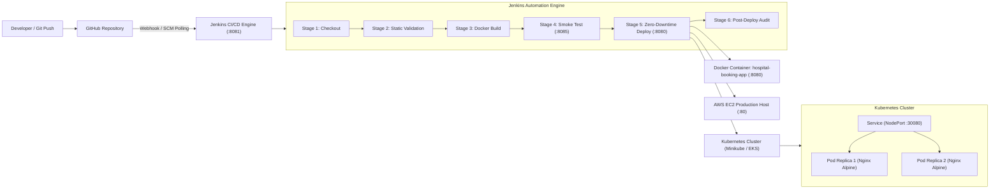

# 🏥 Hospital Appointment Booking System — End-to-End DevOps Project

[](https://www.jenkins.io/)
[](https://www.docker.com/)
[](https://kubernetes.io/)
[](https://nginx.org/)
[](https://aws.amazon.com/ec2/)
[](https://github.com/archanadevi-bot/Hospital-appointment-Booking-)

An enterprise-ready DevOps implementation for a production-grade **Hospital Appointment Booking System**. This project transforms an existing multi-page HTML5/CSS3/JavaScript web application into a fully automated, containerized, and orchestrated cloud deployment pipeline.

---

## 📑 Table of Contents

- [DevOps Architecture](#-devops-architecture)
- [Project Overview & Application Workflow](#-project-overview--application-workflow)
- [Tools & Technologies](#-tools--technologies)
- [Repository Directory Structure](#-repository-directory-structure)
- [Stage 1: Docker Containerization](#-stage-1-docker-containerization)
- [Stage 2: Docker Compose Orchestration](#-stage-2-docker-compose-orchestration)
- [Stage 3: Git & GitHub Version Control](#-stage-3-git--github-version-control)
- [Stage 4: Jenkins CI/CD Automation](#-stage-4-jenkins-cicd-automation)
- [Stage 5: Kubernetes Container Orchestration](#-stage-5-kubernetes-container-orchestration)
- [Stage 6: AWS Cloud Deployment](#-stage-6-aws-cloud-deployment)
- [Placement Interview Preparation Guide](#-placement-interview-preparation-guide)

---

## 🏗️ DevOps Architecture



---

## 🩺 Project Overview & Application Workflow

The **Hospital Appointment Booking System** is a pure client-side multi-page application (MPA) designed for outpatient scheduling:

1. **`index.html` (Landing Page)**: Hero header with medical banner image, leading users to doctor directory or booking form.
2. **`doctors.html` (Doctor Directory)**: Dynamically renders doctor cards from `app.js` (Dr. Smith, Dr. Jones, etc. across 8 specialties). Clicking "Book Appointment" saves the selected doctor ID into browser `localStorage` and routes to `booking.html`.
3. **`booking.html` (Appointment Form)**: Doctor dropdown auto-prefilled from directory selection. Features conflict detection (prevents overlapping bookings for the same doctor on the same date). Stores finalized appointments into `localStorage`.
4. **`confirmation.html` (Bookings Dashboard)**: Lists all confirmed appointments from `localStorage` with real-time cancel/delete capabilities.
5. **`style.css`**: Responsive UI styling, card layouts, form designs, and mobile breakpoints.
6. **`app.js`**: Data repository containing doctor details and specialties.

---

## 🛠️ Tools & Technologies

| Domain | Technology | Version | Purpose |
|---|---|---|---|
| **Frontend** | HTML5, CSS3, JavaScript (ES6) | Standard | Client-side application with localStorage state |
| **Web Server** | Nginx Alpine | 1.27-alpine | High-performance reverse proxy & static asset server |
| **Containerization** | Docker Engine | 29.x / Latest | Application packaging with custom non-root configs |
| **Multi-Container** | Docker Compose | v2 spec | Local multi-service orchestration with resource limits |
| **Version Control** | Git & GitHub | 2.x | Source control, branching, release tags, and webhooks |
| **CI/CD Automation**| Jenkins | LTS | Declarative pipeline for automated build, test & deploy |
| **Orchestration** | Kubernetes (k8s) | 1.36+ | Declarative deployments, replica sets, NodePort routing |
| **Cloud Hosting** | Amazon Web Services (AWS) | EC2 | Cloud virtual machine hosting with Security Groups |

---

## 📁 Repository Directory Structure

```text
Hospital-appointment-Booking/
├── .dockerignore                 # Excludes local git, logs, and docs from Docker context
├── .gitignore                    # Prevents build artifacts and OS caches from Git tracking
├── 852d3ae66e2f216bcc1e074c7e0da8da.jpg  # Hero banner background image
├── app.js                        # Doctor dataset array (Root fallback)
├── booking.html                  # Appointment scheduling page with validation
├── confirmation.html             # Confirmed appointments management page
├── css/
│   └── style.css                 # CSS stylesheet in standard directory structure
├── docker-compose.yml            # Multi-container orchestration definition
├── Dockerfile                    # Production-grade multi-stage / Alpine Nginx image
├── doctors.html                  # Dynamic doctor card listing page
├── index.html                    # Application entry point / Landing page
├── Jenkinsfile                   # Declarative Jenkins CI/CD pipeline definition
├── js/
│   └── app.js                    # JavaScript data source in standard directory structure
├── k8s/
│   ├── deployment.yaml           # Kubernetes Deployment (2 Replicas, probes, limits)
│   └── service.yaml              # Kubernetes Service (NodePort 30080)
├── nginx.conf                    # Production Nginx server configuration with /healthz
├── README.md                     # Comprehensive documentation & interview guide
└── scripts/
    └── deploy-aws.sh             # Bash automation script for EC2 server bootstrap
```

---

## 🐳 Stage 1: Docker Containerization

### 1. Production `Dockerfile` Explanation
```dockerfile
FROM nginx:1.27-alpine
RUN rm -rf /usr/share/nginx/html/*
COPY nginx.conf /etc/nginx/conf.d/default.conf
COPY index.html doctors.html booking.html confirmation.html style.css app.js 852d3ae66e2f216bcc1e074c7e0da8da.jpg /usr/share/nginx/html/
COPY css/ /usr/share/nginx/html/css/
COPY js/ /usr/share/nginx/html/js/
RUN chmod -R 755 /usr/share/nginx/html
EXPOSE 80
HEALTHCHECK --interval=30s --timeout=3s --start-period=5s --retries=3 \
  CMD wget -qO- http://127.0.0.1:80/healthz || exit 1
CMD ["nginx", "-g", "daemon off;"]
```

**Key Highlights:**
- **`nginx:1.27-alpine`**: Weighs ~21MB, minimizing the container attack surface and pull times.
- **`HEALTHCHECK`**: Automatically queries `http://127.0.0.1:80/healthz` every 30 seconds; reports healthy status to Docker daemon.
- **`nginx -g "daemon off;"`**: Prevents Nginx from daemonizing into the background, which would cause PID 1 to exit and terminate the container.

### 2. Custom `nginx.conf` Highlights
- **Dual-Stack IP Binding**: Binds to both IPv4 (`listen 80;`) and IPv6 (`listen [::]:80;`).
- **Gzip Compression**: Compresses HTML, CSS, JS, and JSON on the fly, reducing bandwidth by up to 70%.
- **Security Headers**: Includes `X-Frame-Options: SAMEORIGIN`, `X-Content-Type-Options: nosniff`, and `X-XSS-Protection`.
- **`/healthz` Endpoint**: Returns `200 "healthy\n"` without touching disk logs, used by Kubernetes and AWS Application Load Balancers (ALB).
- **Static Asset Caching**: 7-day browser caching with `Cache-Control: public, no-transform`.

### 3. Docker Execution Commands
```bash
# 1. Build the Docker image
docker build -t hospital-booking:latest .

# 2. Run container mapping host port 8080 to container port 80
docker run -d --name hospital-booking-app -p 8080:80 hospital-booking:latest

# 3. Check container status & health
docker ps -f name=hospital-booking-app

# 4. Verify HTTP connectivity & health check
curl -I http://localhost:8080/
curl http://localhost:8080/healthz
```

---

## 🐙 Stage 2: Docker Compose Orchestration

```yaml
services:
  hospital-booking-frontend:
    build:
      context: .
      dockerfile: Dockerfile
    image: hospital-booking:latest
    container_name: hospital-booking-app
    restart: unless-stopped
    ports:
      - "8080:80"
    healthcheck:
      test: ["CMD-SHELL", "wget -qO- http://127.0.0.1:80/healthz || exit 1"]
      interval: 30s
      timeout: 5s
      retries: 3
      start_period: 5s
    deploy:
      resources:
        limits:
          cpus: '0.50'
          memory: 256M
        reservations:
          cpus: '0.10'
          memory: 64M
    networks:
      - hospital-network

networks:
  hospital-network:
    driver: bridge
```

```bash
# Build and start services in the background
docker compose up -d --build

# View running services
docker compose ps

# Stop containers and networks
docker compose down
```

---

## 🐙 Stage 3: Git & GitHub Version Control

### 1. Repository Configuration
- **Remote Repository URL**: `https://github.com/archanadevi-bot/Hospital-appointment-Booking-.git`
- **Default Production Branch**: `main`
- **Initial Remote History**: Preserved and integrated with original commit `a74c2ab Add files via upload`.

### 2. Git Status & Verification Commands
```bash
# Check repository status
git status

# Inspect branch and remote tracking
git branch -vv

# Check verified commit history
git log --graph --oneline -n 5

# Remote URL verification
git remote -v
```

### 3. Pushing Future Code Changes
```bash
# 1. Stage modified files
git add .

# 2. Commit changes with semantic message
git commit -m "feat: your feature description"

# 3. Push to GitHub main branch
git push origin main
```

---

## ⚙️ Stage 4: Jenkins CI/CD Automation

Jenkins automates the lifecycle from source code commit to production container roll-out.

### 1. Port Architecture & Isolation
- **Production Hospital Application**: Runs on host port `8080` (`http://localhost:8080`).
- **Jenkins Controller Dashboard**: Runs on host port `8081` (`http://localhost:8081`) to prevent any port conflict.

### 2. Jenkins Installation via Docker (Windows 11 Best Practice)
To avoid Java runtime version conflicts on the host (where Java 25 is installed, while Jenkins requires Java 17/21 LTS), Jenkins is run inside an official LTS container with Docker socket integration:

```bash
# Create persistent Docker volume for Jenkins configuration
docker volume create jenkins_home

# Run Jenkins on port 8081 with Docker daemon socket access
docker run -d \
  --name jenkins \
  --restart unless-stopped \
  -p 8081:8080 \
  -p 50000:50000 \
  -v jenkins_home:/var/jenkins_home \
  -v /var/run/docker.sock:/var/run/docker.sock \
  jenkins/jenkins:lts

# Retrieve the initial administrator password to unlock Jenkins
docker exec jenkins cat /var/jenkins_home/secrets/initialAdminPassword
```

### 3. Required Jenkins Plugins
Install only the necessary plugins from **Manage Jenkins** → **Plugins**:
- `Pipeline` (Core pipeline engine)
- `Git` & `GitHub Integration` (SCM and webhook triggers)
- `Docker Pipeline` (Enables Docker execution within pipeline steps)
- `AnsiColor` (Colorizes build console output)

### 4. Jenkins Pipeline Workflow (`Jenkinsfile`)
The declarative pipeline consists of 6 automated stages:
1. **1. Checkout**: Clones `main` branch from `https://github.com/archanadevi-bot/Hospital-appointment-Booking-.git` and logs commit hash.
2. **2. Static Validation**: Enforces integrity checks ensuring `index.html`, `doctors.html`, `booking.html`, `confirmation.html`, `style.css`, `app.js`, `Dockerfile`, and `nginx.conf` exist.
3. **3. Docker Build**: Builds `hospital-booking:${BUILD_NUMBER}` and tags it as `hospital-booking:latest`.
4. **4. Automated Testing**: Starts an ephemeral container on test port `8085` and verifies:
   - `/healthz` returns `200 OK`
   - `index.html` returns `200 OK`
   - `doctors.html` returns `200 OK`
   - `css/style.css` and `js/app.js` return `200 OK`
   - Container logs are error-free; cleans up test container.
5. **5. Deployment**: Safely replaces the running container with the validated image on port `8080` (`--restart unless-stopped`).
6. **6. Post-Deployment Verification**: Audits `docker ps`, `docker images`, and performs live HTTP status checks against `http://localhost:8080/`.

### 5. Automated Pipeline Triggers
- **GitHub Webhook (`githubPush()`)**:
  - In GitHub repo: **Settings** → **Webhooks** → **Add webhook**.
  - **Payload URL**: `http://<your-public-jenkins-ip>:8081/github-webhook/`
  - **Content type**: `application/json`
  - **Events**: *Just the push event*.
- **SCM Polling Fallback (`pollSCM('H/5 * * * *')`)**:
  - For local development where localhost is behind NAT/firewall, Jenkins polls GitHub every 5 minutes and automatically triggers a build whenever a new commit is detected.

---

## ☸️ Stage 5: Kubernetes Container Orchestration

Kubernetes (K8s) provides declarative container orchestration, automated healing, scaling, and rolling updates.

### 1. Deployment Specification (`k8s/deployment.yaml`)
- **`replicas: 2`**: Runs two identical pods for high availability.
- **`strategy: RollingUpdate`**: Guarantees zero downtime by spinning up the new version (`maxSurge: 1`) before removing the old version (`maxUnavailable: 0`).
- **`resources`**: Enforces strict requests (`100m` CPU, `64Mi` RAM) and limits (`250m` CPU, `128Mi` RAM) to prevent noisy-neighbor memory exhaustion.
- **`readinessProbe`**: Ensures K8s traffic is only routed to the pod when `/healthz` returns 200.
- **`livenessProbe`**: Detects hung processes and restarts the pod automatically.

### 2. Service Specification (`k8s/service.yaml`)
- **`type: NodePort`**: Exposes port `80` inside the cluster on static port `30080` across all cluster nodes.

### 3. Deployment Commands
```bash
# 1. Apply deployment manifest
kubectl apply -f k8s/deployment.yaml

# 2. Apply service manifest
kubectl apply -f k8s/service.yaml

# 3. Check deployment status
kubectl get deployments
kubectl rollout status deployment/hospital-booking-deployment

# 4. Inspect pods
kubectl get pods -l app=hospital-booking -o wide

# 5. Check service and exposed NodePort
kubectl get services hospital-booking-service

# 6. Test service locally (Minikube / Docker Desktop)
curl http://localhost:30080/healthz
```

---

## ☁️ Stage 6: AWS Cloud Deployment

Deploying the Hospital Booking Application on Amazon Web Services (AWS) using EC2.

### Step 1: Launch an EC2 Instance
1. Sign in to AWS Management Console → **EC2** → **Launch Instance**.
2. **Name**: `Hospital-Booking-Server`
3. **AMI**: `Ubuntu Server 22.04 LTS (HVM)` or `Amazon Linux 2023`.
4. **Instance Type**: `t2.micro` (AWS Free Tier eligible) or `t3.small`.
5. **Key Pair**: Select or create an RSA key pair (`hospital-key.pem`).

### Step 2: Configure Security Group (Firewall)
Create an EC2 Security Group with the following Inbound Rules:

| Type | Protocol | Port Range | Source | Description |
|---|---|---|---|---|
| **SSH** | TCP | 22 | `My IP` | Secure SSH management |
| **HTTP** | TCP | 80 | `0.0.0.0/0` | Public web traffic |
| **Custom TCP** | TCP | 8080 | `0.0.0.0/0` | Jenkins / Docker alternative port |
| **Custom TCP** | TCP | 30080 | `0.0.0.0/0` | Kubernetes NodePort access |

### Step 3: Connect to EC2 & Deploy
```bash
# Connect via SSH
ssh -i hospital-key.pem ubuntu@<ec2-public-ip>

# Clone repository
git clone https://github.com/archanadevi-bot/Hospital-appointment-Booking-.git
cd Hospital-appointment-Booking-

# Run automated deployment script
chmod +x scripts/deploy-aws.sh
./scripts/deploy-aws.sh
```

### Step 4: Access Application
Open your browser and navigate to:
```text
http://<EC2-PUBLIC-IP>/
```

---

## 🎯 Placement Interview Preparation Guide

### Top DevOps Interview Questions for this Project

#### Q1: Why did you choose Nginx Alpine as the base image for this frontend?
> **Answer:** Alpine Linux is an ultra-lightweight Linux distribution (~5MB base). When combined with Nginx, the final image size is under 25MB compared to 150MB+ for Debian-based images. This significantly reduces security vulnerabilities (smaller attack surface), accelerates CI/CD image build and download times, and reduces cloud storage and bandwidth costs.

#### Q2: What is the difference between `readinessProbe` and `livenessProbe` in Kubernetes?
> **Answer:** 
> - **`readinessProbe`** determines if a pod is ready to accept incoming user traffic. If it fails, Kubernetes removes the pod's IP from the Service endpoints so users do not receive errors, but the container is **not** killed.
> - **`livenessProbe`** determines if the container process is still alive and functioning. If it fails, Kubernetes immediately kills and restarts the container based on the restart policy.

#### Q3: Why did you configure `/healthz` inside `nginx.conf` instead of checking `index.html`?
> **Answer:** The `/healthz` endpoint is a dedicated, lightweight endpoint that returns `200 "healthy\n"` directly from memory with `access_log off;`. Checking `index.html` involves disk I/O, loads asset contents into memory, and pollutes access logs with thousands of probe requests every hour.

#### Q4: How does zero-downtime deployment work in your Kubernetes configuration?
> **Answer:** We configured `RollingUpdate` with `maxSurge: 1` and `maxUnavailable: 0`. During an update, Kubernetes spins up 1 new pod with the new container image first. Traffic is only routed to the new pod once its `readinessProbe` succeeds. Only then is the old pod gracefully terminated. Thus, 100% service capacity is maintained throughout deployment.

#### Q5: How does a GitHub Webhook communicate with your Jenkins CI/CD pipeline?
> **Answer:** When a developer pushes commits to GitHub, GitHub sends an HTTP POST payload with JSON metadata to Jenkins' webhook listener URL (`http://<jenkins-url>:8081/github-webhook/`). Jenkins parses the repository URL and branch name, matches it against configured Pipeline jobs, and instantly triggers the build stages without polling.

---

## 👨‍💻 Author & Maintainer
- **Hospital Appointment Booking DevOps Project**
- Developed for production deployment and placement interview demonstrations.
- **Repository**: [archanadevi-bot/Hospital-appointment-Booking-](https://github.com/archanadevi-bot/Hospital-appointment-Booking-)
