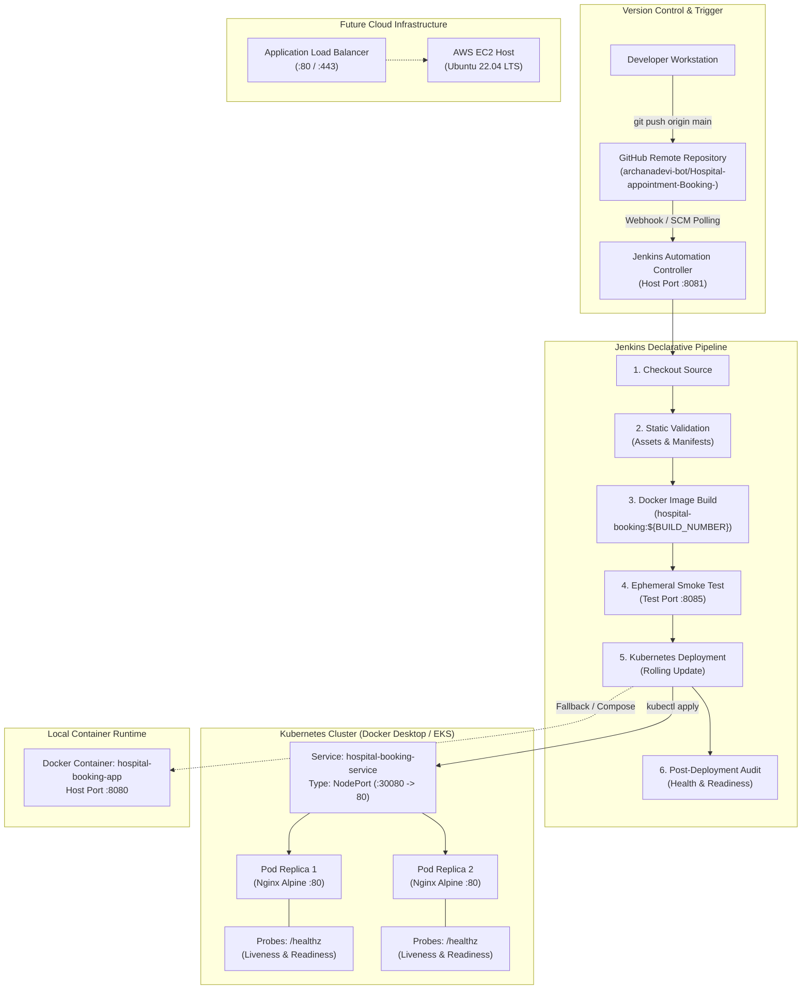
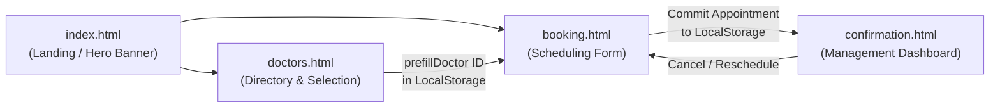
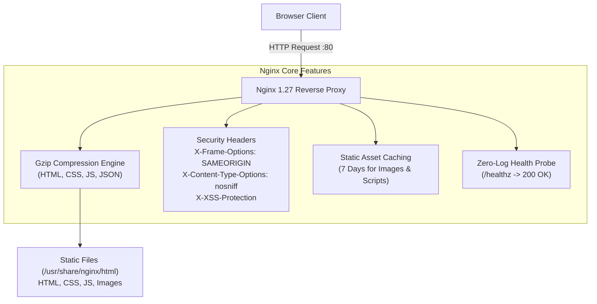
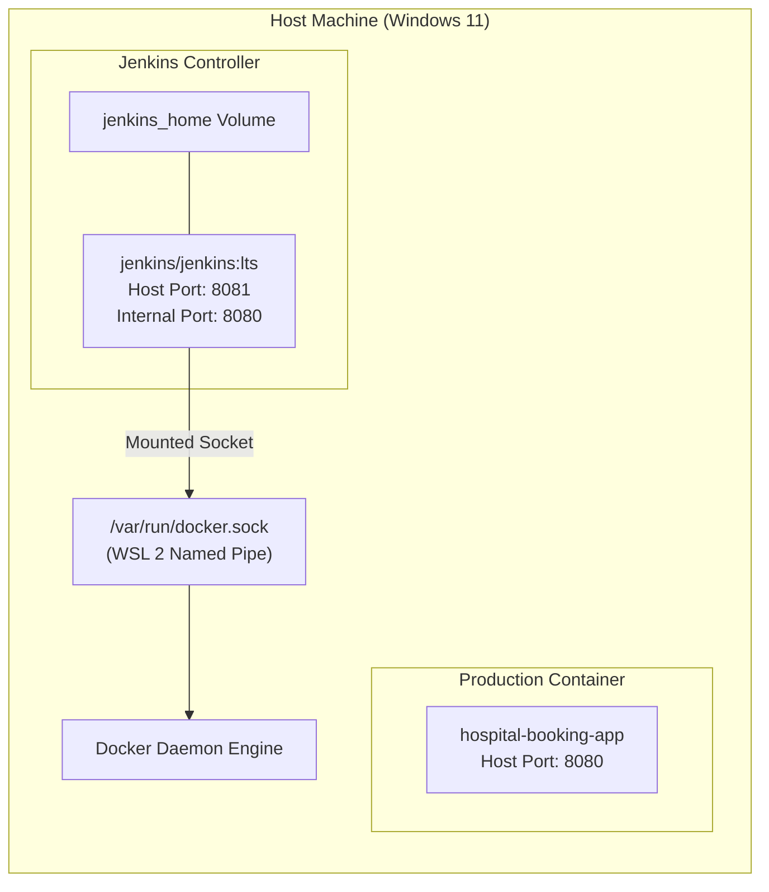
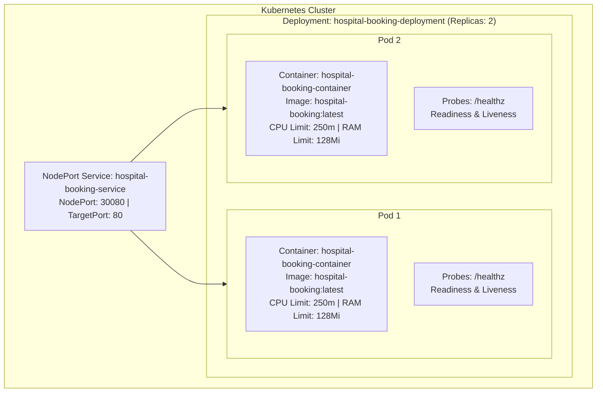

# 🏛️ System Architecture Specification
## Hospital Appointment Booking System — DevOps Implementation

---

## 1. Executive Summary

This document specifies the end-to-end technical architecture of the **Hospital Appointment Booking System** DevOps implementation. The project bridges modern client-side frontend development with enterprise cloud-native DevOps practices, demonstrating a pipeline spanning **Docker containerization**, **Nginx web serving**, **GitHub version control**, **Jenkins CI/CD automation**, **Kubernetes orchestration**, and **AWS cloud hosting architecture**.

---

## 2. End-to-End DevOps Architecture

---

## 3. Application Architecture

The application is structured as a performant, lightweight client-side Multi-Page Application (MPA):

### Component Details
1. **Entry Point (`index.html`)**: Landing page presenting primary actions and medical imagery (`852d3ae66e2f216bcc1e074c7e0da8da.jpg`).
2. **Catalog Page (`doctors.html`)**: Dynamically reads medical specialist profiles from `app.js` and provides single-click routing to the appointment booking page with prefilled state.
3. **Booking Form (`booking.html`)**: Validates patient details, doctor selection, and date conflicts directly against client-side browser storage.
4. **Dashboard (`confirmation.html`)**: Reads booked appointments from `localStorage`, enabling cancellation with real-time UI refresh.
5. **State Management**: State persistence is achieved through browser `localStorage` under the keys `appointments` and `prefillDoctor`.

---

## 4. Web Server & Container Architecture (Nginx Alpine)

The frontend is served using **Nginx 1.27 Alpine**, tuned for production security and low resource utilization:

### Technical Highlights:
- **Image Size**: ~21.1 MB (via Alpine Linux minimal footprint).
- **Dual-Stack Network Binding**: Binds to both IPv4 (`listen 80;`) and IPv6 (`listen [::]:80;`), avoiding Alpine `localhost` lookup connection refusals.
- **Dedicated Health Probe (`/healthz`)**: Returns `200 "healthy\n"` without disk I/O, preventing access log flooding from Kubernetes liveness and readiness probes.

---

## 5. Jenkins CI/CD Automation Architecture

To prevent port conflicts with the running hospital application on port `8080`, Jenkins runs on dedicated host port `8081`:

### Pipeline Flow:
1. **Checkout**: Source code is fetched from GitHub (`origin/main`).
2. **Static Validation**: Shell assertions verify that all mandatory assets and Kubernetes manifests exist.
3. **Docker Build**: The image is packaged with the unique `${BUILD_NUMBER}` tag and latest tag.
4. **Smoke Test**: An ephemeral container starts on test port `8085` to query `/healthz`, `/index.html`, and static assets before teardown.
5. **Kubernetes Deployment**: `kubectl apply` and `kubectl set image` deploy the verified image to the cluster with zero downtime.
6. **Audit**: Queries pod state, rollout status, and service health.

---

## 6. Kubernetes Cluster Architecture

The application is deployed to a Kubernetes cluster using declarative manifests:

### Key Orchestration Properties:
- **High Availability**: 2 pod replicas distributed across nodes.
- **Zero-Downtime Rolling Update**: `maxSurge: 1`, `maxUnavailable: 0` ensures existing traffic is maintained while the new container starts.
- **Health Probing**: Traffic is routed to a pod only when `readinessProbe` succeeds. If a pod stalls, `livenessProbe` triggers automated container restart.
- **Resource Boundaries**: Strict CPU requests (`100m`) and limits (`250m`), memory requests (`64Mi`) and limits (`128Mi`) protect against cluster starvation.

---

## 7. Network & Port Allocation Table

| Service | Environment | Host / Node Port | Internal Container Port | Protocol | Purpose |
|---|---|---|---|---|---|
| **Hospital Web App (Docker)** | Local Production | `8080` | `80` | HTTP | Production access for standalone container |
| **Hospital Web App (K8s)** | Kubernetes Cluster | `30080` | `80` | HTTP | NodePort external ingress to cluster |
| **Ephemeral Test Container** | CI/CD Pipeline | `8085` | `80` | HTTP | Automated pre-deployment validation |
| **Jenkins Dashboard** | CI/CD Controller | `8081` | `8080` | HTTP | Jenkins pipeline management UI |
| **Jenkins JNLP Agent** | CI/CD Agents | `50000` | `50000` | TCP | Inbound agent connection listener |
| **AWS EC2 Production** | Cloud (Future) | `80` | `80` | HTTP | Public web access |

---

## 8. Summary of Architectural Guarantees

1. **Port Safety**: Zero collisions between application (`8080`), CI/CD (`8081`), test containers (`8085`), and Kubernetes NodePort (`30080`).
2. **Resilience**: Client-side conflict detection, Nginx dual-stack binding, and Kubernetes automated pod self-healing.
3. **Observability**: Dedicated `/healthz` endpoint with isolated monitoring and discrete pipeline verification audits.

