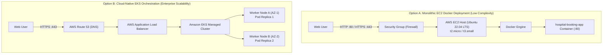

# ☁️ AWS Cloud Future Deployment Guide
## Hospital Appointment Booking System — Cloud-Native Hosting Specification

---

> [!IMPORTANT]
> **Status**: **NOT DEPLOYED (Blueprint Only)**.
> No AWS account has been provisioned, no AWS resources have been launched, and **zero cloud charges have been incurred**. This document serves as an enterprise-grade architectural blueprint for future cloud deployments and technical interview discussions.

---

## 1. Cloud Architecture Overview

Two production deployment strategies are evaluated for the Hospital Appointment Booking System:



---

## 2. Option A: Virtual Machine Deployment on AWS EC2

### A. Instance Sizing & Operating System
- **Instance Type**: `t2.micro` (1 vCPU, 1 GB RAM — AWS Free Tier eligible) or `t3.small` (2 vCPUs, 2 GB RAM).
- **AMI (Amazon Machine Image)**: `Ubuntu Server 22.04 LTS (HVM)` or `Amazon Linux 2023`.
- **EBS Storage**: 20 GB gp3 root volume.

---

### B. Security Group (Firewall) Rule Specification
A dedicated Security Group `hospital-booking-sg` must be created with minimal inbound exposure:

| Type | Protocol | Port Range | Source | Purpose |
|---|---|---|---|---|
| **SSH** | TCP | `22` | `My IP` (e.g. `203.0.113.5/32`) | Secure administrative shell access |
| **HTTP** | TCP | `80` | `0.0.0.0/0` (Anywhere IPv4) | Public web traffic for patients |
| **HTTPS** | TCP | `443` | `0.0.0.0/0` (Anywhere IPv4) | Secure encrypted SSL/TLS traffic |
| **Custom TCP** | TCP | `8080` | `My IP` | Alternative test container staging port |
| **Custom TCP** | TCP | `8081` | `My IP` | Jenkins controller management console |

*Outbound Rules*: Allow all traffic (`0.0.0.0/0`) on all protocols for OS security updates and Docker image downloads.

---

### C. Automated Bootstrap Deployment (`scripts/deploy-aws.sh`)
The existing repository includes an automated EC2 bootstrap script [**`scripts/deploy-aws.sh`**](file:///c:/Users/archa/Downloads/Hospital-appointment-Booking--main/scripts/deploy-aws.sh).

```bash
# Connect to EC2 instance via SSH
ssh -i hospital-key.pem ubuntu@<EC2-PUBLIC-IP>

# Clone GitHub repository
git clone https://github.com/archanadevi-bot/Hospital-appointment-Booking-.git
cd Hospital-appointment-Booking-

# Make script executable and execute deployment
chmod +x scripts/deploy-aws.sh
./scripts/deploy-aws.sh
```

**Script Actions Executed**:
1. Updates OS packages via `apt-get` or `dnf`.
2. Automatically installs the latest official Docker Engine and enables the systemd service.
3. Installs Docker Compose plugin.
4. Builds the production image `hospital-booking:latest` using the Alpine Dockerfile.
5. Launches the container on port `80` with `--restart unless-stopped`.
6. Probes `http://localhost/healthz` to confirm Nginx is healthy.

---

## 3. Option B: Enterprise Orchestration via Amazon EKS

For enterprise multi-region deployments with high availability requirements:

### Architectural Differences: EC2 Docker vs. Amazon EKS
| Feature | Single EC2 Docker | Amazon EKS (Kubernetes) |
|---|---|---|
| **High Availability** | Single point of failure (if VM crashes, site goes down). | Multi-Availability Zone pod distribution and node failover. |
| **Scaling** | Vertical (resize VM) or complex manual scripts. | Automatic Horizontal Pod Autoscaling (HPA) in seconds. |
| **Zero-Downtime Rollouts** | Container restart downtime (2-3 seconds). | Built-in Rolling Updates with readiness probes. |
| **Load Balancing** | Direct port mapping or manual reverse proxy. | AWS Application Load Balancer via AWS Load Balancer Controller. |
| **Cost** | ~$0 (Free Tier) to ~$8/month (`t3.small`). | $73/month base cluster fee ($0.10/hr) + worker EC2 nodes. |
| **Operational Overhead** | Extremely low; simple for single-developer maintenance. | Moderate-to-high; requires K8s control plane knowledge. |

---

## 4. Domain, SSL/TLS & HTTPS Considerations

For production deployments:
1. **Domain Registration**: Register a custom domain (e.g. `hospitalbooking.com`) in **AWS Route 53**.
2. **SSL/TLS Certificates**: Issue a free 2048-bit RSA wildcard certificate using **AWS Certificate Manager (ACM)**.
3. **HTTPS Termination**: Attach the certificate to an AWS **Application Load Balancer (ALB)** listening on port 443. The ALB terminates SSL and forwards cleartext HTTP traffic to container port 80 on EC2, offloading cryptographic overhead from Nginx.

---

## 5. Monitoring, Logging & Cost Optimization

### A. CloudWatch Observability
- **EC2 Metrics**: Monitor CPU utilization, network I/O, and disk read/writes in **Amazon CloudWatch**. Set an alarm if CPU > 80% for 5 consecutive minutes.
- **Container Logs**: Configure the AWS CloudWatch Docker logging driver to stream Nginx access and error logs directly to a CloudWatch Log Group (`/aws/docker/hospital-booking`).

### B. Cost Prevention & Resource Teardown
To ensure zero unexpected AWS charges:
```bash
# 1. Stop container on EC2
sudo docker stop hospital-booking-app
sudo docker rm hospital-booking-app

# 2. Terminate EC2 instance in AWS Console
# EC2 Dashboard -> Instances -> Select Instance -> Instance State -> Terminate Instance

# 3. Release any Elastic IPs associated with the instance to avoid idle IP charges
```
