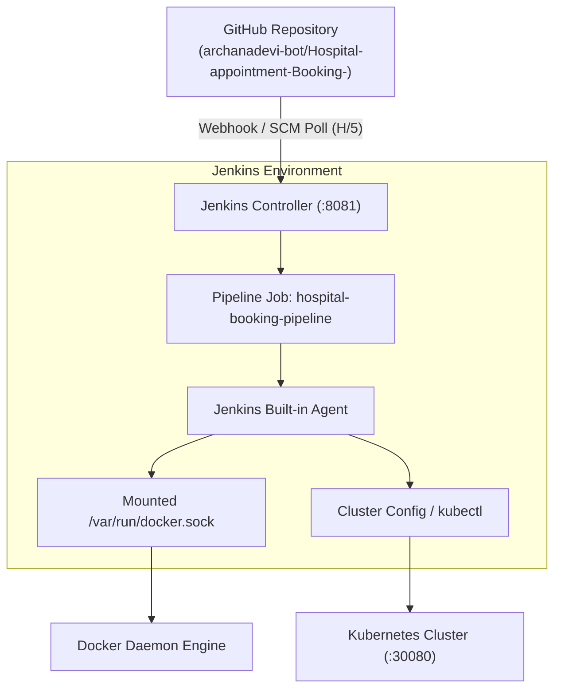

# ⚙️ Jenkins CI/CD Pipeline & Automation Guide
## Hospital Appointment Booking System

---

## 1. CI vs. CD: Core Concepts

| Aspect | Continuous Integration (CI) | Continuous Delivery (CD) | Continuous Deployment (CD) |
|---|---|---|---|
| **Goal** | Frequently integrate code changes into a shared repository. | Ensure code is always in a releasable state. | Automatically deploy every passing commit to production. |
| **Stages** | Linting, Static Validation, Unit Testing, Docker Image Build. | Pre-deployment verification, Staging deployment, Approval gates. | Direct zero-downtime deployment to production containers or Kubernetes. |
| **In this Project** | Checkout, Static Asset Validation, Docker Build, Ephemeral Smoke Test. | Kubernetes manifest staging and image tagging. | Automated rollout to Kubernetes cluster or production container on port `8080`. |

---

## 2. Jenkins Architecture & Setup



### Why Run Jenkins via Docker on Windows 11?
1. **Java Compatibility**: The Windows host machine runs OpenJDK 25 LTS. Jenkins LTS releases officially support **Java 17 and Java 21 LTS**; running Jenkins natively on Java 25 triggers bytecode/classloader incompatibility crashes. The official `jenkins/jenkins:lts` Docker image includes a pre-configured, tested Java 21 LTS environment.
2. **Port Conflict Elimination**: The hospital application uses host port `8080`. Jenkins is mapped to host port `8081` (`-p 8081:8080`), ensuring complete network independence.
3. **Environment Isolation**: Jenkins state, build histories, and plugins persist in a dedicated Docker volume (`jenkins_home`), preventing local file pollution.

---

## 3. Launching and Unlocking Jenkins

```powershell
# 1. Create persistent Docker volume for Jenkins data
docker volume create jenkins_home

# 2. Run Jenkins container mapping port 8081 with Docker socket access
docker run -d `
  --name jenkins `
  --restart unless-stopped `
  -p 8081:8080 `
  -p 50000:50000 `
  -v jenkins_home:/var/jenkins_home `
  -v /var/run/docker.sock:/var/run/docker.sock `
  jenkins/jenkins:lts

# 3. Retrieve the Initial Administrator Password
docker exec jenkins cat /var/jenkins_home/secrets/initialAdminPassword
```

### Setup Steps:
1. Navigate to **`http://localhost:8081`** in your browser.
2. Enter the administrator password output from step 3.
3. Choose **"Install suggested plugins"**.
4. Once completed, install the required supplementary plugin:
   - Go to **Manage Jenkins** &rarr; **Plugins** &rarr; **Available plugins**.
   - Search for **Docker Pipeline** and click **Install**.

---

## 4. Detailed `Jenkinsfile` Breakdown

The project uses a **Declarative Pipeline** with 6 automated stages:

### Stage 1: Checkout
```groovy
stage('1. Checkout') {
    steps {
        checkout scm
        script {
            def branchName = env.GIT_BRANCH ?: 'main'
            def commitHash = sh(returnStdout: true, script: 'git rev-parse --short HEAD').trim()
            echo "Branch: ${branchName} | Commit: ${commitHash} | Build: ${BUILD_NUMBER}"
        }
    }
}
```
- Retrieves code from GitHub.
- Logs git metadata (branch name, commit hash, build number) to console logs for full auditability.

### Stage 2: Static File Validation
```groovy
stage('2. Static File Validation') {
    steps {
        sh '''
            test -f index.html        || { echo "ERROR: Missing index.html"; exit 1; }
            test -f doctors.html      || { echo "ERROR: Missing doctors.html"; exit 1; }
            test -f booking.html      || { echo "ERROR: Missing booking.html"; exit 1; }
            test -f confirmation.html || { echo "ERROR: Missing confirmation.html"; exit 1; }
            test -f style.css         || { echo "ERROR: Missing style.css"; exit 1; }
            test -f app.js            || { echo "ERROR: Missing app.js"; exit 1; }
            test -f nginx.conf        || { echo "ERROR: Missing nginx.conf"; exit 1; }
            test -f Dockerfile        || { echo "ERROR: Missing Dockerfile"; exit 1; }
        '''
    }
}
```
- Fail-fast mechanism: If a developer inadvertently renames or deletes an essential asset, the pipeline halts immediately before consuming resources on a Docker build.

### Stage 3: Docker Image Build
```groovy
stage('3. Docker Image Build') {
    steps {
        sh '''
            docker build -t ${DOCKER_IMAGE}:${IMAGE_TAG} .
            docker tag ${DOCKER_IMAGE}:${IMAGE_TAG} ${DOCKER_IMAGE}:latest
        '''
    }
}
```
- Builds the immutable artifact tagged with the unique `${BUILD_NUMBER}` for rollbacks and `latest` for standard deployments.

### Stage 4: Container Smoke Testing
```groovy
stage('4. Container Smoke Testing') {
    steps {
        sh '''
            docker rm -f ${DOCKER_IMAGE}-test 2>/dev/null || true
            docker run -d --name ${DOCKER_IMAGE}-test -p ${TEST_PORT}:80 ${DOCKER_IMAGE}:${IMAGE_TAG}
            sleep 3

            # Probe all core endpoints
            curl -s -f http://localhost:${TEST_PORT}/healthz      || exit 1
            curl -s -f http://localhost:${TEST_PORT}/index.html    || exit 1
            curl -s -f http://localhost:${TEST_PORT}/doctors.html  || exit 1
            curl -s -f http://localhost:${TEST_PORT}/css/style.css || exit 1
            curl -s -f http://localhost:${TEST_PORT}/js/app.js     || exit 1

            docker rm -f ${DOCKER_IMAGE}-test
        '''
    }
}
```
- Starts an ephemeral container on dedicated test port `8085`.
- Probes `/healthz` and all HTML, CSS, and JS routes with `curl -s -f`. If any endpoint fails, the pipeline halts and tears down the container.

### Stage 5: Kubernetes Deployment (With Local Fallback)
```groovy
stage('5. Kubernetes Deployment') {
    steps {
        sh '''
            if kubectl cluster-info > /dev/null 2>&1; then
                kubectl apply -f k8s/
                kubectl set image deployment/hospital-booking-deployment hospital-booking-container=${DOCKER_IMAGE}:${IMAGE_TAG} --record=true || true
                kubectl rollout status deployment/hospital-booking-deployment --timeout=120s
            else
                docker stop ${CONTAINER_NAME} 2>/dev/null || true
                docker rm ${CONTAINER_NAME} 2>/dev/null || true
                docker run -d --name ${CONTAINER_NAME} --restart unless-stopped -p ${HOST_PORT}:80 ${DOCKER_IMAGE}:latest
                sleep 3
                curl -s -f http://localhost:${HOST_PORT}/healthz || exit 1
            fi
        '''
    }
}
```
- Automatically detects if a Kubernetes cluster is reachable.
- If Kubernetes is present: Triggers a zero-downtime rolling update via `kubectl set image` and awaits rollout completion.
- If running standalone: Deploys the production container on port `8080` safely.

### Stage 6: Post-Deployment Verification
```groovy
stage('6. Post-Deployment Verification') {
    steps {
        sh '''
            if kubectl cluster-info > /dev/null 2>&1; then
                kubectl get deployments -l app=hospital-booking
                kubectl get pods -l app=hospital-booking -o wide
                kubectl get svc -l app=hospital-booking
                curl -s -f http://localhost:${NODE_PORT}/healthz && echo "Kubernetes Service is HEALTHY!"
            else
                docker ps -f name=^/${CONTAINER_NAME}$
                curl -s -f http://localhost:${HOST_PORT}/healthz && echo "Docker Container is HEALTHY!"
            fi
        '''
    }
}
```
- Performs a live runtime audit of the deployed pods, services, and HTTP response.

---

## 5. Webhook & SCM Polling Configuration

### Dual-Trigger Strategy:
1. **GitHub Webhook (`githubPush()`)**:
   - Ideal for public cloud runners where GitHub can send HTTP POST payloads directly to Jenkins.
   - Configure in GitHub: `http://<jenkins-url>:8081/github-webhook/`.
2. **SCM Polling Fallback (`pollSCM('H/5 * * * *')`)**:
   - Solves the local localhost/NAT limitation where GitHub cannot reach local IP addresses.
   - Jenkins initiates outbound queries to GitHub every 5 minutes to detect and trigger new commits automatically.

---

## 6. Troubleshooting Jenkins

| Issue | Cause | Fix |
|---|---|---|
| Port 8080 collision | Jenkins default port matches hospital app. | Map Jenkins to host port 8081 (`-p 8081:8080`). |
| `docker: command not found` inside Jenkins | Jenkins container lacks Docker CLI binary. | Ensure Docker socket is mounted (`-v /var/run/docker.sock:/var/run/docker.sock`) and Docker CLI is installed in container. |
| Permission denied on `docker.sock` | Container user lacks socket read/write permissions. | Run `docker exec -u 0 jenkins chmod 666 /var/run/docker.sock`. |
| Pipeline hangs during test stage | Test container port `8085` blocked or conflicting. | Ensure no other process is bound to port 8085 using `Get-NetTCPConnection -LocalPort 8085`. |
