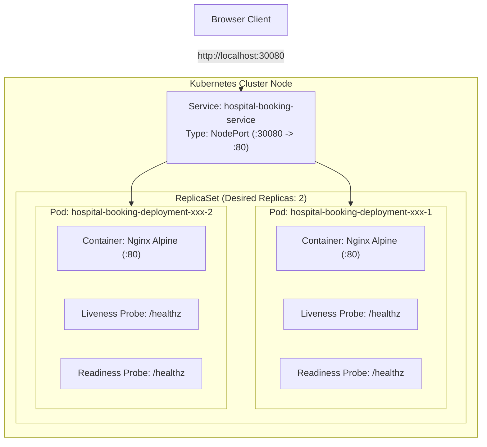

# ☸️ Kubernetes Container Orchestration Guide
## Hospital Appointment Booking System

---

## 1. Kubernetes Architecture & Core Concepts

Kubernetes (K8s) is an open-source container orchestration engine that automates container deployment, scaling, failover, and load balancing across cluster nodes.



### Core Primitive Definitions:
- **Pod**: The smallest deployable computing unit in Kubernetes. A pod encapsulates one or more co-located containers, shared network namespaces, and storage volumes.
- **Deployment**: A higher-level controller that manages declarative pod updates, replica counting, automated rolling updates, and rollback capabilities.
- **ReplicaSet**: A low-level controller maintained by the Deployment that ensures the specified number of identical pod replicas are running at all times.
- **Service**: An abstract REST object that defines a logical set of pods and an access policy. Provides stable IP addresses and internal DNS resolution despite pods being ephemeral.
- **NodePort**: A service type that opens a specific static port (`30000-32767`) on all cluster nodes, routing external traffic directly to target pod containers.
- **ConfigMap**: Stores non-confidential configuration data as key-value pairs, decoupling application configuration from container images.

---

## 2. Environment Selection: Docker Desktop K8s vs. Minikube

For Windows 11 with WSL 2 and Docker Desktop:
- **Recommended Choice**: **Docker Desktop Kubernetes**.
- **Rationale**:
  1. **Direct Image Availability**: In Docker Desktop, the Docker Engine and the local Kubernetes cluster share the same underlying container runtime (`containerd`/Docker daemon). When `docker build -t hospital-booking:latest .` executes, the image is **immediately accessible to Kubernetes pods** without requiring an external registry or manual `minikube image load` copies.
  2. **Resource Efficiency**: Uses the existing WSL 2 VM rather than spinning up an auxiliary Hyper-V VM or dedicated Minikube Docker container.
  3. **Simplicity**: Can be enabled via a single checkbox in Docker Desktop Settings &rarr; Kubernetes &rarr; "Enable Kubernetes".

---

## 3. Kubernetes Manifest Breakdown

### A. Deployment Manifest (`k8s/deployment.yaml`)
```yaml
apiVersion: apps/v1
kind: Deployment
metadata:
  name: hospital-booking-deployment
  labels:
    app: hospital-booking
    tier: frontend
spec:
  replicas: 2
  strategy:
    type: RollingUpdate
    rollingUpdate:
      maxSurge: 1
      maxUnavailable: 0
  selector:
    matchLabels:
      app: hospital-booking
  template:
    metadata:
      labels:
        app: hospital-booking
        tier: frontend
    spec:
      containers:
      - name: hospital-booking-container
        image: hospital-booking:latest
        imagePullPolicy: IfNotPresent
        ports:
        - containerPort: 80
          name: http
        resources:
          requests:
            cpu: "100m"
            memory: "64Mi"
          limits:
            cpu: "250m"
            memory: "128Mi"
        livenessProbe:
          httpGet:
            path: /healthz
            port: 80
          initialDelaySeconds: 10
          periodSeconds: 15
          timeoutSeconds: 3
          failureThreshold: 3
        readinessProbe:
          httpGet:
            path: /healthz
            port: 80
          initialDelaySeconds: 5
          periodSeconds: 10
          timeoutSeconds: 2
          successThreshold: 1
          failureThreshold: 2
```

#### Key Elements Explained:
1. **`replicas: 2`**: Maintains two identical instances of the Nginx frontend pod for redundancy.
2. **`RollingUpdate (maxSurge: 1, maxUnavailable: 0)`**: Ensures 100% service uptime during deployments. Kubernetes spins up 1 new pod first; traffic only routes to the new pod once its `readinessProbe` succeeds; only then is the old pod terminated.
3. **`imagePullPolicy: IfNotPresent`**: Crucial for local development; instructs Kubernetes to use local images cached on the machine before attempting an external registry pull.
4. **`readinessProbe`**: Determines if the pod is ready to accept incoming user traffic. If it returns anything other than 200, Kubernetes temporarily detaches the pod's IP from the service endpoint.
5. **`livenessProbe`**: Monitors internal process health. If Nginx hangs or crashes and fails 3 consecutive checks, Kubernetes terminates and restarts the container automatically.
6. **`resources`**: Requests guarantee minimal compute allocation, while limits prevent memory leaks from starving other cluster workloads.

---

### B. Service Manifest (`k8s/service.yaml`)
```yaml
apiVersion: v1
kind: Service
metadata:
  name: hospital-booking-service
  labels:
    app: hospital-booking
    tier: frontend
spec:
  type: NodePort
  selector:
    app: hospital-booking
  ports:
    - name: http
      port: 80
      targetPort: 80
      nodePort: 30080
```
- **`selector: app: hospital-booking`**: Matches the pod template labels defined in `deployment.yaml`.
- **`nodePort: 30080`**: Exposes the service externally on port `30080` on `localhost`.

---

## 4. Execution & Verification Workflow

```bash
# 1. Verify cluster connectivity
kubectl cluster-info
kubectl get nodes

# 2. Deploy application manifests
kubectl apply -f k8s/

# 3. Check deployment and rollout progress
kubectl get deployments -l app=hospital-booking
kubectl rollout status deployment/hospital-booking-deployment

# 4. Inspect pods, IPs, and node assignments
kubectl get pods -l app=hospital-booking -o wide

# 5. Inspect exposed service
kubectl get services hospital-booking-service

# 6. Deep dive deployment inspection
kubectl describe deployment hospital-booking-deployment

# 7. Check container logs across replicas
kubectl logs -l app=hospital-booking --tail 20

# 8. Test live application via NodePort
curl -I http://localhost:30080/
curl http://localhost:30080/healthz
```

---

## 5. Scaling Demonstration

Horizontal Pod Autoscaling / Manual Scaling:

```bash
# Scale deployment from 2 to 3 replicas
kubectl scale deployment hospital-booking-deployment --replicas=3

# Verify pod scaling (3 pods running)
kubectl get pods -l app=hospital-booking

# Scale back to baseline 2 replicas
kubectl scale deployment hospital-booking-deployment --replicas=2

# Verify pod termination and stabilization
kubectl get pods -l app=hospital-booking
```

### Self-Healing Demonstration:
If an active pod is forcefully deleted:
```bash
# Simulate a sudden pod crash by manually deleting one pod
kubectl delete pod <pod-name>

# Immediately check pod list
kubectl get pods -l app=hospital-booking
```
*Result*: The Deployment's ReplicaSet immediately detects that the active count dropped to 1 and instantiates a replacement pod within seconds to restore the desired state of 2 replicas.

---

## 6. Rolling Updates & Rollback Demonstration

### Performing a Rolling Update:
```bash
# Update container image to a newly tagged build
kubectl set image deployment/hospital-booking-deployment \
  hospital-booking-container=hospital-booking:latest --record=true

# Monitor rollout progression in real-time
kubectl rollout status deployment/hospital-booking-deployment
```

### Checking Rollout History:
```bash
kubectl rollout history deployment/hospital-booking-deployment
```

### Executing an Instant Rollback:
```bash
# Roll back to previous revision
kubectl rollout undo deployment/hospital-booking-deployment

# Verify rollback status
kubectl rollout status deployment/hospital-booking-deployment
```

---

## 7. Troubleshooting Kubernetes Deployments

| Error | Root Cause | Solution |
|---|---|---|
| `ImagePullBackOff` / `ErrImageNeverPull` | Pod cannot locate container image in registry or local cache. | Ensure image is tagged locally (`docker tag hospital-booking:latest`) and set `imagePullPolicy: IfNotPresent`. |
| `CrashLoopBackOff` | Application inside container exits immediately upon start. | Inspect container logs with `kubectl logs <pod-name>`. For Nginx, ensure `daemon off;` is active. |
| Pod stuck in `Pending` | Insufficient CPU/Memory resources on cluster node. | Review node capacity (`kubectl describe node`) and adjust `resources.requests` in `deployment.yaml`. |
| Pod unready (`0/1 Running`) | `readinessProbe` failing on `/healthz`. | Verify health endpoint inside pod: `kubectl exec <pod-name> -- wget -qO- http://127.0.0.1:80/healthz`. |

